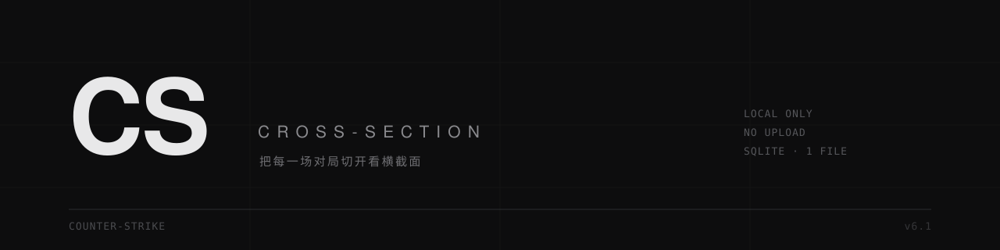

# Cross-Section

**v6.2.1** · 修订于 2026-10-24 · [更新记录](CHANGELOG.md)

**把每一场 CS2 对局切开，看横截面。**

> [!WARNING]
> **使用前须知**
>
> **一、非官方项目。** 本软件为独立开发的第三方工具，与 Valve Corporation 无任何关联，未获其授权、赞助或背书。`Counter-Strike`、`CS2` 及相关标识为 Valve 的商标。
>
> **二、不接触游戏进程。** 本软件仅读取本地 `.dem` 录像文件并作离线统计；不读取游戏内存、不注入代码、不修改游戏文件、不模拟输入，不提供任何游戏内优势，不属于作弊工具。
>
> **三、不对账号状态作任何保证。** 反作弊系统的策略与判定由第三方独立实施并可能随时变更，作者无法控制。使用本软件所产生的账号相关后果由用户自行承担。
>
> **四、统计结果不保证准确。** 不保证与 HLTV、Leetify 或任何平台的自有统计数值一致。结果仅供个人参考，不得用于赌博、投注、赛事裁决、职业选拔或任何涉及金钱的决策。
>
> **五、游戏素材版权归 Valve。** `cs2tool/web/icons/` 与 `cs2tool/web/maps/` 内素材的著作权属 Valve Corporation，商业分发须自行取得授权。
>
> 完整条款见 [**DISCLAIMER.md**](DISCLAIMER.md)。下载、解压、运行即视为接受。

本地运行的 CS2 对局分析工具。把 `.dem` 丢进目录，它解析成可查的数据：能力画像、逐场趋势、武器与道具细节、残局与多杀、回合级回放。

全部在你自己电脑上跑 —— **数据不上传、不需要账号、没有遥测**。唯一的对外请求是去 GitHub 问一句「有没有新版本」（见 [常见问题](#常见问题)）。可选装一个 [AutoPull 增量包](#可选自动拉取官匹-demoautopull-增量包)，那部分的联网行为单独说明。

<sub>Local CS2 demo analytics. Everything stays on your machine: no account, no upload, no telemetry.</sub>

---

## 它是什么

演示文件（`.dem`）里记录了一整场比赛的每一个 tick。大多数人只用它看回放，但它同时是一份完整的账本：谁在第几回合买了什么、哪一枪打在哪里、谁在残局里活下来。

Cross-Section 做的事，是把这个账本翻成可读的东西 —— 而且只给你自己看。

| | |
|---|---|
| **解析层** | 开源的 [awpy](https://github.com/pnxenopoulos/awpy) 3.1.1，不是自己写的解析器 |
| **存储** | 单个 SQLite 文件 `data/cs2.db`，可以直接拷走或备份 |
| **回放** | 按回合生成，四栏 HUD + 地图雷达 + 双轨回合轴 |
| **导出** | CSV 全量数据，能直接喂给 AI 分析 |
| **接口** | `/api/v1/*` 只读 JSON 接口，方便自己接脚本 |

它**只读 demo**：不读游戏进程、不注入、不修改任何游戏文件。跟游戏客户端之间没有交互 —— 设计上不构成被反作弊检测的行为（但不对账号状态作任何保证，见 [DISCLAIMER.md](DISCLAIMER.md)）。

---

## 功能

- **概览** —— Rating 2.0、ADR、KAST、Impact、K/D、首杀率、补枪与拉枪占比，配逐场趋势
- **能力画像** —— 从击杀、生存、残局、多杀等事件里算出的分维能力，看自己长什么样、和在变好还是变差
- **武器** —— 每把枪的击杀数、命中率、爆头率、每击杀耗弹
- **回合事件** —— 首杀、多杀、残局（1v1~1v5）、结束原因、下包拆包
- **经济** —— 每回合的经济差、购买类型分档、起枪节奏
- **道具** —— 闪光/烟雾/燃烧/高爆的投掷与效果（致盲时长、伤害）
- **地图数据** —— 按图池拆分胜率与各项指标
- **回放播放器** —— 回合级走位重演，可拖时间轴
- **导出** —— 一键 CSV，全量明细

界面里的每个指标名都能悬浮看定义和公式，不用猜这个数字是怎么算出来的。

---

## 装法（Windows x64）

从 [Releases](../../releases/latest) 下载最新的 `Cross-Section-v*.zip`（约 4.7 MB），解压到任意目录，双击 `START.bat`。

**不需要预装 Python、不需要 pip、不需要管理员权限。** 首次启动时它自己装一套运行环境：

- Python 3.12 embeddable（约 11 MB）
- awpy + polars 等 10 个依赖（约 60 MB）

全部从国内镜像拉（清华 → 阿里 → 腾讯 → 华为云，逐个回退，实测第一顺位就通），大概一两分钟。**只有第一次需要联网**，之后启动秒开；升级时覆盖程序文件也不会重下环境。装好的东西都在程序目录的 `python/` 里，删掉整个文件夹就干净了。

也可以手动提前跑 `SETUP.bat` —— 跟首次启动自动做的是同一件事，只是能提前看到进度。

### 已经装了 Python 的话

需要 Python 3.10+：

```bash
pip install -r requirements.txt
python cs2tool/server.py --port 8790
```

这条路径不会用 `python/` 目录里的运行时。

浏览器会自动打开 `http://127.0.0.1:8790`。

---

## 快速开始

1. 双击 `START.bat`（或跑上面那条命令）
2. 把 `.dem` 放进 `demos/` 目录 —— 或者在 Demo 页点「⇩ 从 CS2 拉取」自动从游戏目录复制
3. 打开 **Demo 页** → 点「分析未处理」
4. 等进度条走完，回主页看数据

第一次启动会自动创建 `demos/`、`data/` 两个目录。所有东西都在程序自己那一层 —— **删掉整个文件夹就干净了**，注册表、AppData、我的文档里什么都没留。

**「我」是谁怎么认**：工具需要知道你是哪个玩家才能算个人数据。它会依次读设置里的 steamid、读库里标记过的玩家、按跨场出现次数自动推断。推断错了就在顶栏下拉里手动选一次，之后会记住。

---

## 可选：自动拉取官匹 demo（AutoPull 增量包）

正式包里**不包含**这个功能。它需要借你本机 Steam 的登录态，属于可选件，所以单独发：

1. 下载 `Cross-Section-AutoPull-v*.zip`（只有 8 KB）
2. 解压到程序根目录（和 `START.bat` 同一层）
3. 重启程序

之后 Demo 页会多出 **AutoPull 区域**，两个功能：

- **最近比赛** —— 一次取最近 8 场 + 每场的完整下载地址，库里已有的自动跳过
- **按分享码指定场次** —— 粘分享码补任意早的场次（Valve 没有「给我更早的比赛」这种接口，所以只能一场一个码）

**不需要任何配置**：不用 API Key、不用认证码、不用分享码起点了。它借本机已登录的 Steam 走 Steamworks 的本地接口，不要密码、也不读浏览器 cookie。**用之前要把 CS2 完全退出**（游戏占着 GC 会话）。

不想要了就删掉 `cs2tool/gc_pull.py` 再重启，界面自动收回。

原理、限制、风险声明都在压缩包里的 `AUTOPULL.md`，**装之前请读一遍**。

---

## 更新

有新版本时，左上角版本号旁边会出现一个 `NEW` 标记，点一下直接跳到发布页。

升级方式：下载新包解压后覆盖到安装目录，**但保留你自己的 `data/` 和 `demos/`**（一个是统计库，一个是原始 demo）。更稳的做法是解压到新目录，再把旧的 `data/` 整个搬过去。

版本检查每天最多请求一次，结果缓存在本地。断网、GitHub 不可达时静默跳过，不影响任何功能。

---

## 指标怎么算

公式都写在界面里的悬浮提示上，这里说口径上的几个决定：

- **总伤害** 封顶到目标剩余血量，避免过量伤害把 ADR 虚高
- **Rating 2.0** 用 HLTV 的公开公式（社区整理版，非官方文档）
- **Rating 3.0 没有公开公式，本项目不实现** —— 与其给你一个无法复核的数字，不如不给
- 样本不足时显示 `—`，不显示 `0`

---

## 数据存在哪

```
Cross-Section/
├── data/
│   ├── cs2.db          ← 全部统计（一个 SQLite 文件，约 2 MB / 5 场）
│   ├── replays/        ← 回放数据（约 3-5 MB / 场）
│   └── settings.json   ← 你的设置
├── demos/              ← 原始 .dem 文件
└── python/             ← 便携运行时（源码版没有这个目录）
```

备份 = 拷 `data/cs2.db`。迁移 = 整个文件夹搬走。

---

## 常见问题

**会不会被 VAC 封？**
它只读磁盘上的 `.dem` 文件，不接触游戏进程、不注入、不读写游戏内存 —— 与游戏客户端零交互。但**不对账号状态作任何保证**：反作弊策略与判定不由本项目控制，风险自负。

**第一次解析为什么慢？**
一场 180 MB、20 回合的 demo 大约 8-15 秒 —— 要逐个 tick 解析击杀、伤害、道具和投掷轨迹。

**能分析别人的 demo 吗？**
能。任何 CS2 官匹/平台的 `.dem` 都行，切到对应玩家就能看他的视角。

**数据会传到哪去？**
哪都不去。程序只会发**一个** GET 请求去 GitHub 公开 API 问「最新版本号是多少」，返回结果只用于在版本号旁边显示一个 `NEW` 标记。这个请求不携带任何本地数据、不带 cookie、不含设备标识。除此之外没有任何网络行为——「从 CS2 拉取」也是本地目录复制，不走网络。

装了 **AutoPull 增量包**是唯一例外：它会连接 Steam 的 Game Coordinator 取你自己的比赛列表，并在首次使用时从 GitHub 官方 release 下载 `boiler-writter`。这些行为只在你点那个按钮时发生，正式包本身永远不会碰它们。

**为什么叫 Cross-Section？**
Cross-Section 是「横截面」。数据是一层层堆起来的，切开才看得见里面。缩写 CS，和这游戏同名 —— 故意的。

---

## 许可与声明

- 本项目代码以 **MIT** 发布，全文见 [LICENSE](LICENSE)
- **免责、商标、反作弊、数据准确性、责任限制的完整条款见 [DISCLAIMER.md](DISCLAIMER.md)** —— 下载、解压、运行即视为接受
- 解析引擎：[awpy](https://github.com/pnxenopoulos/awpy) (MIT) —— 如果你要用本工具产出的数据做公开分析，请一并注明 awpy
- 图标与地图雷达底图来自 Counter-Strike 2 客户端资源，版权归 **Valve Corporation**；仅为离线显示而随包分发，如权利人提出异议将立即移除
- 本项目与 Valve Corporation **无任何关联**，未获其授权、赞助或背书。Counter-Strike、CS2 及相关标识是 Valve 的商标
- 完整的依赖与许可清单见 [THIRD-PARTY-NOTICES.md](THIRD-PARTY-NOTICES.md)

---

## 支持

本软件免费且开源，全部功能均无付费限制。

如本软件对你有帮助，可通过爱发电赞助：[**爱发电 · Nitrous Oxide**](https://ifdian.net/a/Nitrous_Oxide153)

更具实际意义的支持方式：提交 Issue 反馈统计偏差、指标定义不清或界面缺陷。

---

## License

[MIT](LICENSE)
